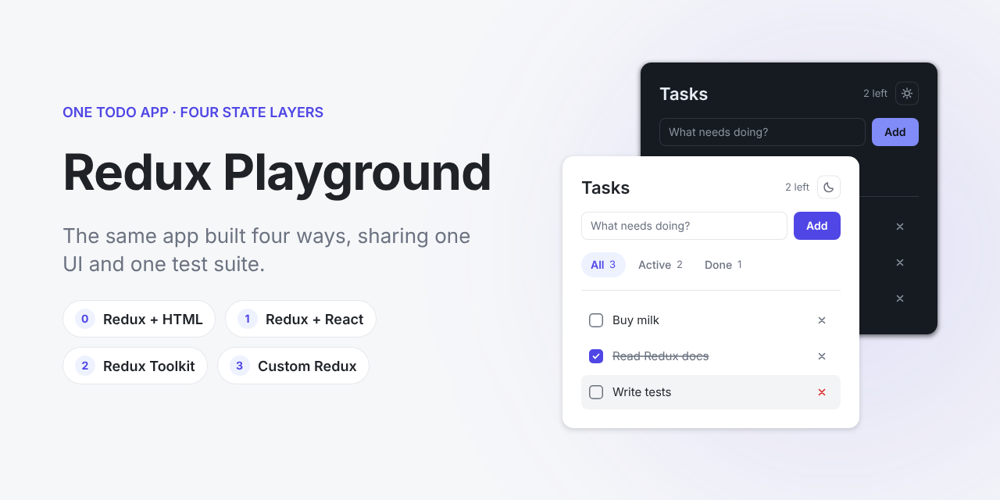

# Redux Playground

One todo app, four implementations of its state layer, side by side:

- **Redux + HTML**: Redux with plain TypeScript and the DOM, no framework
- **Redux + React**: classic Redux with action creators, `switch` reducers and `react-redux`
- **Redux Toolkit**: the same app with `createSlice`, `configureStore` and `createAsyncThunk`
- **Custom Redux**: a from-scratch implementation of `createStore`, middleware and the React bindings

Every version shares the same UI and passes the same component tests.

See the [design](docs/design/README.md) for every screen in light and dark mode, and the design system.
