# Design

UI design for the todo app, the same in every app in this repo. The source is the Penpot file **Redux Playground**; these PNGs are exports of its boards.

## Design system

Colours (light and dark), typography, spacing, radius and components.

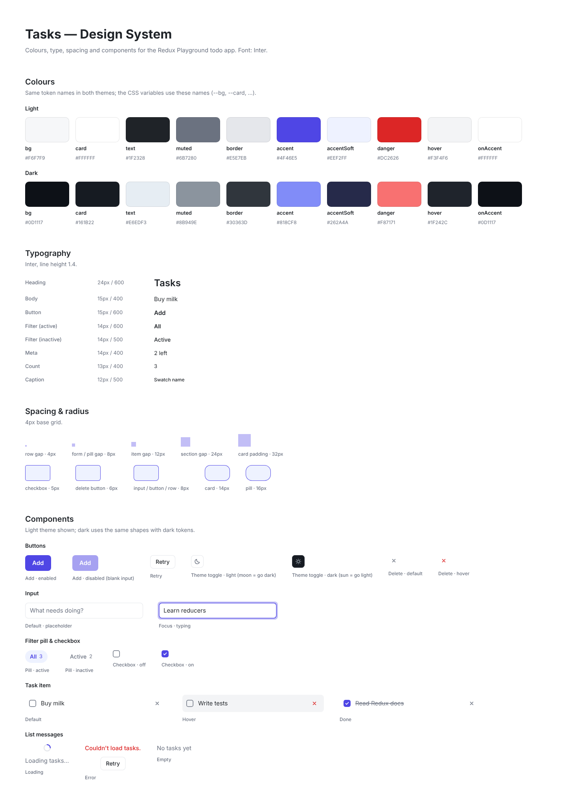

## Screens

Each state of the app in light and dark mode. The theme toggle in the header switches between them.

| State | Light | Dark |
|---|---|---|
| **Default**: three tasks, one done; hover on "Write tests" | 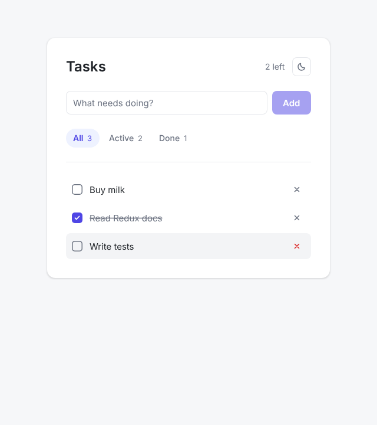 | 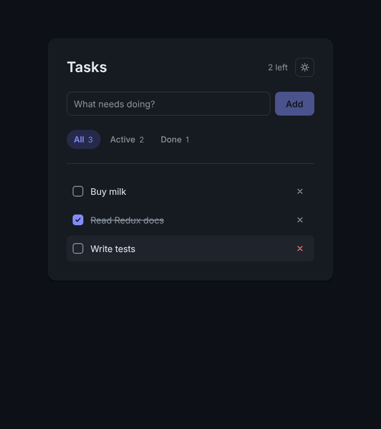 |
| **Typing**: input focused, Add enabled | 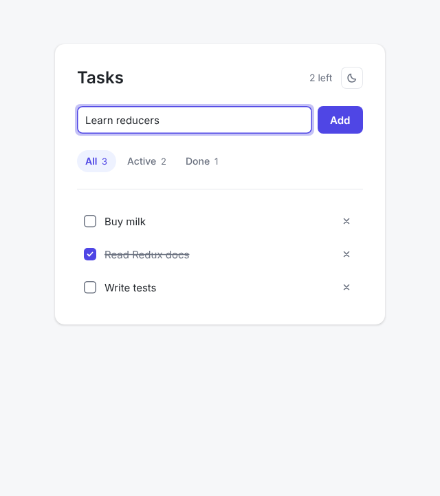 | 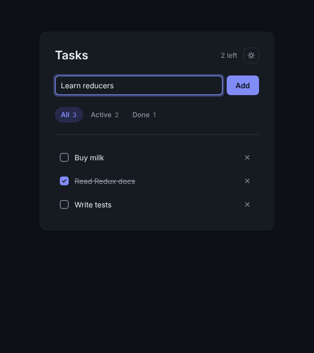 |
| **Filter Active**: only tasks that aren't done | 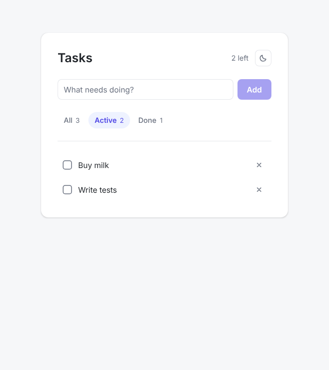 | 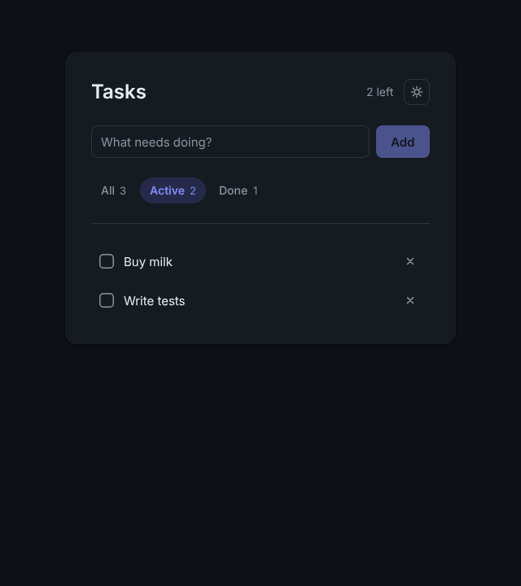 |
| **Loading**: tasks loading from the fake API | 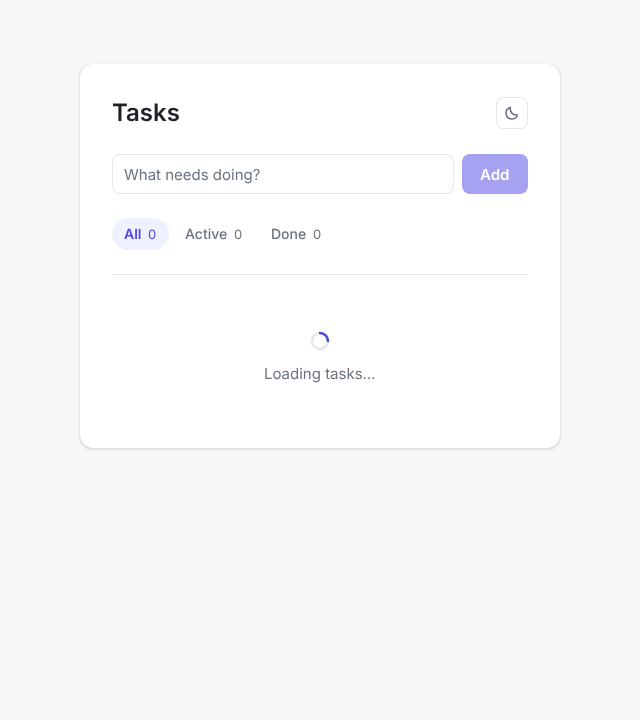 | 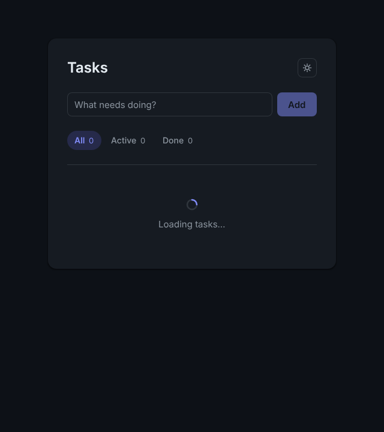 |
| **Error**: loading failed, with Retry | 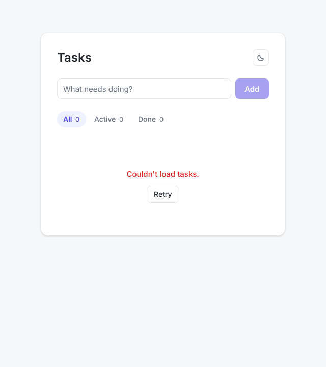 | 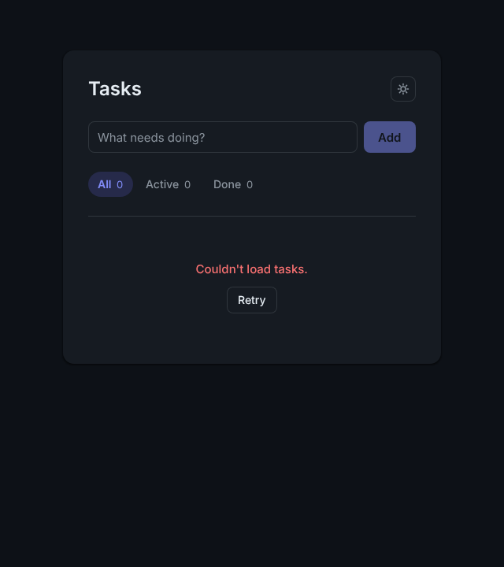 |
| **Empty**: no tasks | 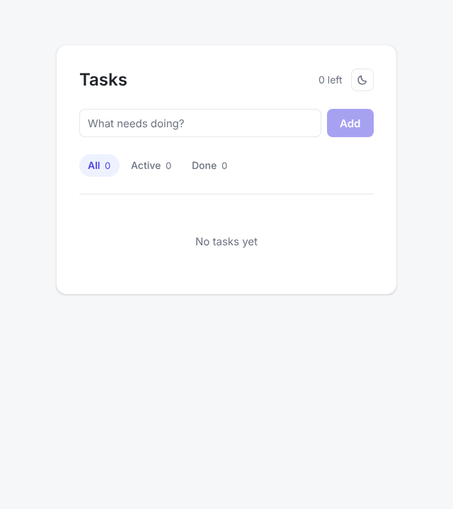 | 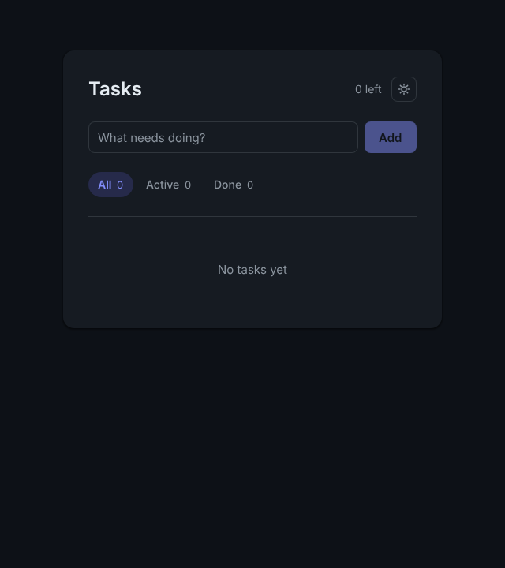 |
